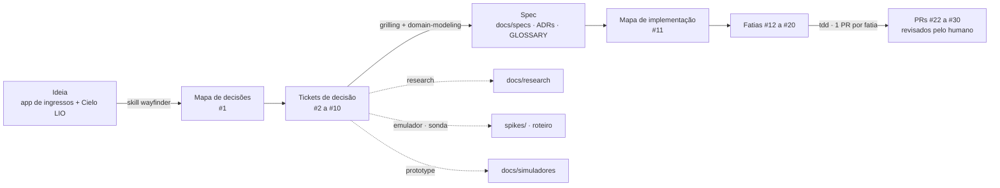

# Cielo Ticket Sales

App Android (Kotlin) de venda de ingressos para eventos locais, pago numa maquininha **Cielo Smart / LIO**. Desafio técnico.

> **Status:** concluído. As 9 fatias do [mapa de implementação](https://github.com/railsonrsa/cielo-ticket-sales/issues/11) estão na `main`, com `./gradlew test lint` verde na CI (145 testes). O fluxo com a Cielo foi conferido à mão no emulador dela; as evidências estão em [`docs/evidencias/`](docs/evidencias/).

## O que o app faz

O Operator escolhe os Events no catálogo, monta o Cart e toca em **Pagar**. O app grava a Purchase e só então abre a Cielo. Na aprovação, ele emite um Ticket com QR por unidade, baixa a Capacity e esvazia o Cart, tudo numa transação. "Minhas compras" mostra o histórico, o comprovante e os Tickets. Cada falha da Cielo tem uma resposta na tela: cancelado, negado, sem resposta, esgotado depois de pagar, cobrança duplicada, valor divergente e aprovação atrasada ([falhas](docs/specs/falhas.md)).

## Da ideia ao código

O projeto saiu de uma frase ("app de ingressos pago na Cielo LIO") para 9 PRs em dois mapas de GitHub Issues: um **de decisões** e um **de implementação**. A IA propôs, pesquisou e escreveu; o humano respondeu cada pergunta e revisou cada PR.



### Onde está cada coisa

| Etapa | O que é | Onde |
|---|---|---|
| 1. Mapa de decisões | Destino, notas, uma linha por decisão fechada e o que saiu de escopo | [#1](https://github.com/railsonrsa/cielo-ticket-sales/issues/1) (label `wayfinder:map`) |
| 2. Tickets de decisão | Uma pergunta por ticket, fechada com um comentário "Resolução" | pesquisa [#2](https://github.com/railsonrsa/cielo-ticket-sales/issues/2) · emulador [#9](https://github.com/railsonrsa/cielo-ticket-sales/issues/9) · grilling [#3](https://github.com/railsonrsa/cielo-ticket-sales/issues/3)–[#8](https://github.com/railsonrsa/cielo-ticket-sales/issues/8), [#10](https://github.com/railsonrsa/cielo-ticket-sales/issues/10) |
| 3. Spec | O estado atual de cada decisão, uma página por área | [`docs/specs/`](docs/specs/), [`docs/adr/`](docs/adr/), [`GLOSSARY.md`](GLOSSARY.md) |
| 4. Mapa de implementação | A ordem das fatias, as dependências e o que cortar se o prazo apertar | [#11](https://github.com/railsonrsa/cielo-ticket-sales/issues/11) (label `impl:map`) |
| 5. Fatias | Uma fatia vertical por ticket, do domínio à tela | [#12](https://github.com/railsonrsa/cielo-ticket-sales/issues/12)–[#20](https://github.com/railsonrsa/cielo-ticket-sales/issues/20) (label `impl:slice`; `hitl` quando precisou do emulador) |
| 6. PRs | Um por fatia, `impl/<n>-<tema>`, com `Closes #n` | [#22](https://github.com/railsonrsa/cielo-ticket-sales/pull/22)–[#30](https://github.com/railsonrsa/cielo-ticket-sales/pull/30) |
| 7. Diários e prompts | Um diário por sessão, com a tabela de onde o humano corrigiu a IA, e os prompts do humano | [`docs/ai/sessions/`](docs/ai/sessions/), [`docs/ai/prompts.md`](docs/ai/prompts.md) |

### Um exemplo de ponta a ponta: cobrança duplicada

1. **Pergunta.** O mapa [#1](https://github.com/railsonrsa/cielo-ticket-sales/issues/1) abriu o ticket [#4 Estratégia contra cobrança duplicada](https://github.com/railsonrsa/cielo-ticket-sales/issues/4), bloqueado pela pesquisa [#2](https://github.com/railsonrsa/cielo-ticket-sales/issues/2) e pelo emulador [#9](https://github.com/railsonrsa/cielo-ticket-sales/issues/9).
2. **Fatos.** A pesquisa (skill `research`) achou que a Cielo não tem idempotência. O emulador confirmou o pior caso: **cobrou duas vezes o mesmo `reference`**.
3. **Grilling.** Foram 2 rodadas e 10 perguntas, cada uma com a resposta que a IA recomendava. O humano corrigiu uma delas: a IA queria ler `lio://orders` "da mais antiga para a mais nova", como no emulador, e o humano pediu a busca pelas duas pontas, porque a ordem não é documentada.
4. **Registro.** A resolução virou comentário no #4, uma linha no #1, o [ADR 0001](docs/adr/0001-anti-duplicidade-e-reconciliacao.md), o termo **Reconciliation** no glossário e a spec de [pagamento Cielo](docs/specs/pagamento-cielo.md).
5. **Código.** O mapa [#11](https://github.com/railsonrsa/cielo-ticket-sales/issues/11) partiu a decisão em fatias: a trava de gravar antes de disparar no [#15](https://github.com/railsonrsa/cielo-ticket-sales/issues/15) e a Reconciliation no [#18](https://github.com/railsonrsa/cielo-ticket-sales/issues/18), conferida à mão no emulador. As duas tiveram os testes de domínio escritos antes do código (skill `tdd`).

As instruções do agente estão em [`AGENTS.md`](AGENTS.md). O método, as skills e o balanço de onde o humano corrigiu a IA estão em [`docs/ai/`](docs/ai/).

## Como rodar

Requisitos: Android SDK e **JDK 17** (o JBR do Android Studio é Java 25 e quebra o build). Para pagar de verdade, também um AVD Android 10 ARM64 sem Google Play com o emulador da Cielo; o passo a passo está no [roteiro do emulador](docs/emulador/roteiro-de-verificacao.md).

```bash
export JAVA_HOME=~/Library/Java/JavaVirtualMachines/jbr-17.0.14/Contents/Home
./gradlew installDemoDebug    # app com a maquininha simulada, sem emulador
./gradlew installCieloDebug   # app pagando no emulador da Cielo
./gradlew test lint           # testes e lint (o mesmo que a CI roda)
```

O build tem dois flavors: o `cielo` paga de verdade por Deep Link (`:payment:cielo-lio`), e o `demo` usa a `FakePaymentTerminal` (`:payment:fake`). Os dois instalam lado a lado (o `demo` ganha o sufixo `.demo`).

**Para avaliar sem o emulador da Cielo**, use o `demo`. Depois do "Pagar", ele abre uma "maquininha simulada" com um botão para cada desfecho: aprovar, aprovar com atraso (fecha sem resposta e aprova 30 s depois), cancelar, erro, negado, sem autenticação, valor divergente e resposta ilegível. O Voltar fecha sem resposta, como na Cielo. O Event "Voz e Violão" tem só 2 lugares, para dar para esgotar.

## Testes

| Nível | Onde | O que prova |
|---|---|---|
| Use cases (JUnit puro, TDD) | `:core:domain` | a trava de uma `AwaitingPayment` por vez, o callback idempotente, a aprovação atrasada, a Reconciliation e a saída `Abandoned` |
| Room real (Robolectric) | `:core:data` | a aprovação atômica contra SQL de verdade, o seed e cada migração |
| ViewModels | `:feature:*` | `UiState` e efeitos |
| Tradução da Cielo | `:payment:cielo-lio` | Base64 → desfecho e `lio://orders` → páginas, com fixtures capturadas no emulador |
| UI Compose (Robolectric) | `:app` | o caminho feliz: Cart → Pagar → aprovada → Minhas compras, com a `FakePaymentTerminal` |

Só fakes escritos à mão, sem MockK. A estratégia completa está em [testes](docs/specs/testes.md). O emulador da Cielo fica fora da automação e é verificado à mão pelo [roteiro](docs/emulador/roteiro-de-verificacao.md).

## Decisões

A spec está em [`docs/specs/`](docs/specs/), uma página por área: [domínio](docs/specs/dominio.md) · [pagamento Cielo](docs/specs/pagamento-cielo.md) · [arquitetura](docs/specs/arquitetura.md) · [persistência](docs/specs/persistencia.md) · [testes](docs/specs/testes.md) · [falhas](docs/specs/falhas.md). As decisões difíceis de reverter estão nos [ADRs](docs/adr/), e o vocabulário no [`GLOSSARY.md`](GLOSSARY.md). O histórico de cada decisão está no [mapa](https://github.com/railsonrsa/cielo-ticket-sales/issues/1) (ver [Da ideia ao código](#da-ideia-ao-código)). A pesquisa da documentação da Cielo está em [`docs/research/`](docs/research/cielo-lio-sdk.md). Os projetinhos descartáveis que responderam perguntas antes da spec estão em [`spikes/`](spikes/).

## Arquitetura e libs

Nove módulos Gradle: `core` (domain em Kotlin puro, data, ui), `payment` (cielo-lio, fake) e três features, cada uma só com presentation. Compose + MVVM, Koin, Room, Navigation Compose tipada, convention plugins. O build quebra se uma feature depender de outra. Detalhes em [arquitetura](docs/specs/arquitetura.md).

## Integração Cielo

Por **Deep Link `lio://`** (o SDK foi descontinuado e a Cielo exige deep link), disparado de um foreground service. O callback chega numa Activity sem UI do módulo Cielo. A Cielo não tem idempotência, e no emulador **cobrou duas vezes o mesmo `reference`**, então a anti-duplicidade é toda nossa: gravar antes de disparar e reconciliar via `lio://orders`. A aprovação é a soma dos `payments[].amount` aprovados, porque o `paidAmount` veio 0 em pagamento aprovado. Ver [pagamento Cielo](docs/specs/pagamento-cielo.md) e o [ADR 0001](docs/adr/0001-anti-duplicidade-e-reconciliacao.md).

## Trade-offs, revistos no fim

- **`targetSdk 29`**, a recomendação da Cielo, em vez do target mais recente. Evita o tipo de FGS e a permissão de notificação. Se manteve: o FGS do disparo rodou no emulador sem nada além disso.
- **Camada por módulo, e não por feature.** A aprovação atômica atravessa as três features. Se manteve: as features só se falam por callbacks de navegação no `:app`, e o domínio cresceu sem tocar nelas.
- **Aprovação atrasada sem lugar vira estorno**, em vez de emitir Ticket além da lotação. O cliente pode ser cobrado e precisar de estorno, mas a Capacity nunca mente. Na implementação apareceu um caso que a spec não previa: uma aprovação no tempo certo também pode ficar sem lugar, se uma atrasada levou os lugares. Ela cai no mesmo estorno ([emenda ao ADR 0001](docs/adr/0001-anti-duplicidade-e-reconciliacao.md)).
- **Só fakes nos testes, sem MockK.** Os cenários críticos dependem de estado. Se manteve: a mesma fake de repositório serve aos testes de domínio e de ViewModel, e a `FakePaymentTerminal` virou também o flavor de demonstração.
- **Flavors `demo`/`cielo`** em vez de uma chave em tempo de execução. O APK `cielo` não carrega a fake, e o manifest da Cielo não vai para a demo. O custo é que o teste de UI só roda no `demo`.
- **Estorno marcado, não executado.** O app mostra o que estornar (valor, `authCode`, `cieloCode`, `orderId`), mas o estorno é manual na maquininha.

## O que ficou fora

**Limitações conhecidas:**

- A aprovação atrasada só foi vista na fake. Na Cielo de verdade, ela depende de o callback chegar depois da Reconciliation, e isso não foi reproduzido.
- A Reconciliation foi conferida com 10 Orders (2 páginas). Uma lista com mais de 3 páginas no emulador não foi vista.
- Em "Minhas compras" aberta, uma Purchase que ganha Pending Refund sobe para o topo, e o selo dela fica acima da tela até o Operator rolar. Reabrir a tela resolve.
- O lint avisa de versões mais novas (AGP 9, Kotlin 2.4); a atualização ficou fora.

**Com mais tempo:** estorno pelo app (`lio://payment-reversal`) · TTL do Cart · QR assinado e validação na portaria (exige backend) · Capacity entre várias maquininhas (exige backend) · catálogo de Events vindo de um backend/BFF, com o Room como cache, em vez do seed local no device · migração do catálogo de Events · design visual próprio · analytics e monitoring sem GMS · criptografia em repouso (SQLCipher/Keystore) · filtro de tentativas falhas · cobertura com Kover.
